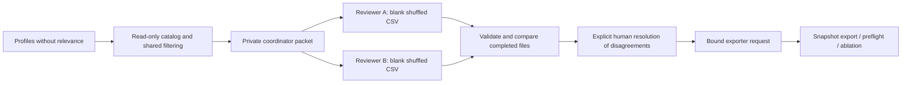

# Annotation, legacy export evaluation, and container runtime

The corrected catalog now has an [offline review and scenario-pilot workflow](catalog-review-pilot.md).

This guide connects the final preparation steps: measure flat exports correctly,
collect independent F3 relevance judgments, and run the API in a reproducible
container. New code/comments use English. Begin with the intuition, then follow
the linked schemas and orchestration functions.

## 1. Legacy evaluator: missing data cannot be a correct prediction

The old flat evaluator compared str(prediction) with str(reference). When both
fields were absent, both became "None", producing an incorrect accuracy of 1.0.

[analysis_exports.py](../app/evaluation/analysis_exports.py) now validates the
reference benchmark first and calls the same classification_metrics() used by
the newer evaluation pipeline. [The CLI](../scripts/evaluate_analysis_exports.py)
retains its argument names and direct-script/module invocation forms:

```powershell
python -m scripts.evaluate_analysis_exports --task f1 --benchmark evals/f1_color_cases.sample.json --predictions evals/local/predictions.json --output build/legacy/report.json
python scripts/evaluate_analysis_exports.py --task f2 --benchmark evals/f2_body_cases.sample.json --predictions evals/local/body-predictions.json --output build/legacy/body-report.json
```

The committed sample reference files are schema examples, not a measured image
benchmark. Predictions still use predicted_primary_season, predicted_sub_season
or predicted_shape, keyed by case_id.

Contracts:

- F1 references require canonical expected_primary_season. Sub-season is optional;
  if present it must agree with the primary season.
- F2 references require canonical expected_shape.
- Empty benchmarks, duplicate/blank IDs, non-object rows, unknown prediction IDs,
  and mismatched row/key IDs fail rather than being dropped or overwritten.
- Missing predictions remain misses in the full labeled denominator.
- Invalid output labels remain incorrect; unexpected strings appear in confusion
  matrices. Missing output fields are reported separately.
- Sub-season accuracy is null when there are no sub-season reference labels.
- Existing accuracy/missing_predictions keys remain. Additional classification
  fields expose coverage, support, macro F1 and confusion matrices.
- The legacy explicit --output flag retains its overwrite behavior. Use a new
  report path for each experiment.

These checks compare labels, not objective visual truth. Reference annotation
quality remains an external input.

## 2. Annotation intuition: freeze the question before asking reviewers

F3 relevance depends on a fixed profile and eligible candidate pool. Showing
reviewers the model's ordering, confidence or bias tags risks copying the
system's own reasoning into its reference judgments.

The preparation command therefore runs only filtering and image deduplication.
It does not rank candidates. Each reviewer receives a separately shuffled list
with visible target season/body/occasion and item name/category/image link.
Grades start blank. Confidence, vectors, bias tags and model scores are omitted.

For isolated F3 evaluation, prepare profiles from agreed reference F1/F2 labels.
Using model-derived profiles instead measures a different, end-to-end question;
record that choice in annotation_protocol. The tool does not choose it for you.



Read in this order:

1. [annotation_schema.py](../app/evaluation/annotation_schema.py): plan, task and packet.
2. [annotation_packet.py](../app/evaluation/annotation_packet.py): build the pool and reviewer files.
3. [annotation_csv.py](../app/evaluation/annotation_csv.py): completed-file validation.
4. [annotation_review.py](../app/evaluation/annotation_review.py): compare and resolve.

## 3. Prepare the plan and distribute only reviewer folders

Copy [the plan example](../evals/templates/relevance-annotation.plan.example.json)
to evals/local/annotation-plan.json. Unlike the final exporter request, this plan
has no relevance labels. It contains dataset identity, synthetic declaration,
protocol, pseudonymous subject IDs, split and profile.

```powershell
python -m scripts.prepare_relevance_annotation --plan evals/local/annotation-plan.json --database evals/local/catalog-copy.db --output-dir build/annotation/packet-001 --reviewer-one rater-a --reviewer-two rater-b --seed 42
```

The explicit source DB is opened through the existing read-only catalog boundary.
No application DB startup, user history, model call or image download occurs.
All eligible, image-deduplicated candidates become tasks; empty pools fail.

Output layout:

```text
packet-001/
  private/packet.json       # coordinator only: canonical plan, task keys, catalog hash
  rater-a/ratings.csv        # blank grades/notes, fixed context
  rater-a/reference.html     # readable item/context list
  rater-b/ratings.csv
  rater-b/reference.html
```

Distribute only the assigned reviewer directory, not the whole packet tree.
This is procedural blinding, not OS-level access control. Two different reviewer
IDs do not prove that two different people worked independently.

HTML opens remote image links only when selected; it contains no automatic image
fetch or script. Reviewer CSV display fields are escaped as literal spreadsheet
text when needed. Save completed CSV files as UTF-8 and edit only grade and notes.
Rows may be reordered; immutable IDs/context must remain unchanged.

Use the protocol's rubric, with integer grades:

| Grade | Meaning |
| --- | --- |
| 0 | Irrelevant |
| 1 | Weakly relevant |
| 2 | Relevant |
| 3 | Strongly relevant |

Complete ratings independently before discussion. The scripts cannot supply
human judgments, verify expertise, or establish consent.

## 4. Import, inspect disagreements, and adjudicate explicitly

```powershell
python -m scripts.review_relevance_annotations --packet build/annotation/packet-001/private/packet.json --first evals/local/rater-a.csv --second evals/local/rater-b.csv --output-dir build/annotation/review-001
```

Each file must contain every assigned (case_id, outfit_id) pair exactly once.
Blank/non-integer grades, wrong packet/reviewer IDs, edited context, duplicate,
missing, or unknown tasks are errors. No incomplete row becomes grade zero.

The review produces:

- review.json: both grades/notes, exact agreement counts and file hashes.
- review.md: a compact status summary.
- disagreements.csv: the two grades and notes for disputed pairs.
- resolution.csv: one blank grade/reason per disagreement.
- export-request.json only when every task has a consensus grade.

Exit code 2 after writing the review means disagreements remain unresolved.
Malformed/incomplete input is rejected before report creation. Exact agreement
is descriptive; it is not accuracy or proof of independent annotation.

For a disagreement, a designated human fills resolution.csv with a grade and a
non-empty reason. The tool never averages grades, picks a reviewer automatically,
or asks an AI to decide. A resolution can choose any grade from 0 through 3.

```powershell
python -m scripts.review_relevance_annotations --packet build/annotation/packet-001/private/packet.json --first evals/local/rater-a.csv --second evals/local/rater-b.csv --resolutions evals/local/resolution.csv --output-dir build/annotation/complete-001
python -m scripts.export_retrieval_snapshot --request build/annotation/complete-001/export-request.json --database evals/local/catalog-copy.db --output-dir build/annotation/export-001
```

The final request retains the full private profile for ranking, an annotation
packet ID and expected_catalog_sha256. Export verifies that the ordered catalog
records/vectors still match annotation preparation. If the catalog changed, it
fails rather than applying old judgments to a new candidate universe. Existing
manually created requests without this optional binding remain supported.

The coordinator must keep private reviewer data and completed real annotation
files outside version control, for example in ignored evals/local/.

## 5. Synthetic annotation smoke

```powershell
python -m scripts.run_annotation_smoke --output-dir build/annotation/smoke-001
```

Only this smoke command fills artificial grades from explicitly synthetic
fixtures. It creates one deliberate disagreement, validates the unresolved state,
applies a synthetic resolution, exports a bound snapshot and runs retrieval
preflight. It checks that source DB bytes remain unchanged. These are software
workflow checks, not human annotation results.

## 6. Container intuition: image is code, volume is mutable data

[Dockerfile](../Dockerfile) installs production requirements and copies only app/
and data/. Test tools, model weights, notebooks, local DBs, Git and .env files are
excluded by [.dockerignore](../.dockerignore). The runtime uses UID/GID 10001
rather than root. No API key is baked into an image.

[compose.yaml](../compose.yaml) publishes the API on loopback port 8000 by default
and mounts a named volume at /var/lib/sacvoc. DATABASE_URL points there. Existing
host SQLite files are not automatically imported or modified.

```powershell
docker compose config --quiet
docker compose up --build -d
docker compose ps
docker compose logs api
```

The service can start without a Gemini key for health/history/readiness checks.
Actual analysis requires your configured key/model. Compose reads selected
environment variables, including values from a local .env when present; do not
publish a rendered configuration containing secrets.

- GET /health checks process health.
- GET /health/ready checks recommendation readiness. A fresh unseeded volume is
  expected to be degraded until the existing catalog/vector preparation is done.
- API_BIND_HOST and API_PORT override the default host binding/port.
- Stopping the service with docker compose down retains the named data volume.
  Volume deletion is a separate destructive action; normal verification never
  removes user Compose volumes.
- For database transfer, use a consistent SQLite backup/offline copy, preserving
  committed WAL state. This container setup performs no automatic migration from
  your host database.

The image tracks the Python 3.12 slim-bookworm tag. Requirements retain their
project pins; an image digest in verification output identifies the exact build.

## 7. Verify the runtime without touching application data

```powershell
python -m scripts.verify_docker_runtime --build --image sacvoc-backend:local --output build/docker/runtime-001.json
```

The script creates a uniquely named disposable volume and two temporary containers.
It checks process health, empty history, degraded unseeded readiness, non-root UID,
absence of test/Torch packages and source secrets, then verifies SQLite persistence
after replacing the first container. It calls no Gemini endpoint. Finally it
removes only the exact container IDs and temporary volume created by that run.

Backend CI now includes annotation smoke plus a separate Docker build/runtime job.
Hosted execution still needs an actual remote workflow run; local validation is
not a claim that GitHub jobs passed.

See [handoff.md](handoff.md) for the remaining real-data work.

Official references: [Dockerfile](https://docs.docker.com/reference/dockerfile/),
[Python image](https://hub.docker.com/_/python),
[Compose](https://docs.docker.com/reference/compose-file/services/).
