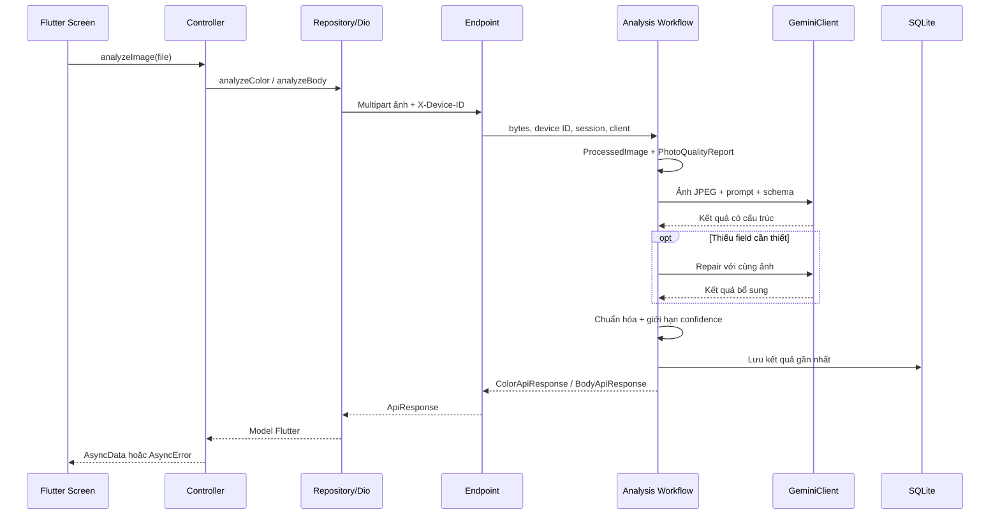
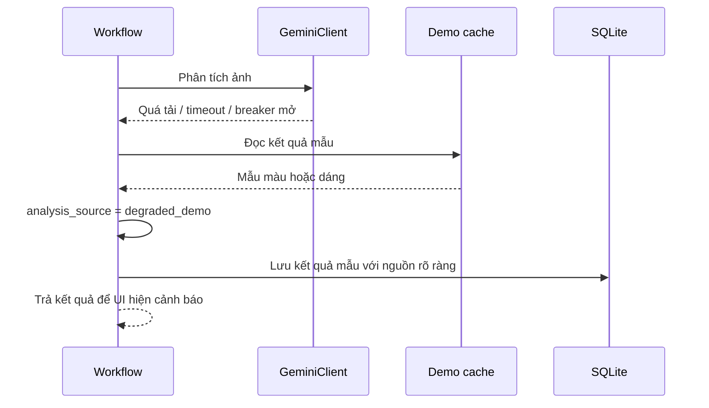
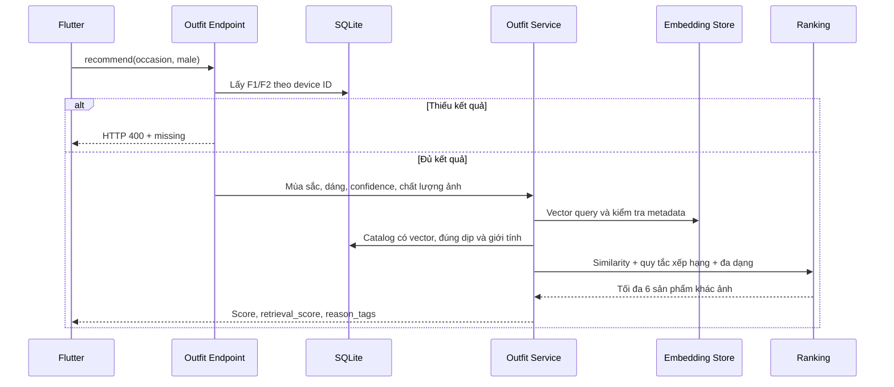
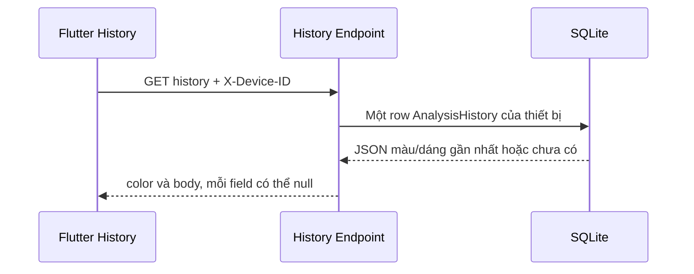

# Đọc Sắc Vóc từ đầu

Sắc Vóc có ba bước nghiệp vụ: F1 nhận diện mùa sắc từ selfie; F2 nhận diện dáng người từ ảnh toàn thân; F3 lấy hai kết quả gần nhất để đề xuất trang phục nam. Flutter hiển thị và gửi ảnh; backend phân tích, lưu kết quả và tìm sản phẩm.

## Bắt đầu đọc ở đâu?

1. [Điểm khởi động](../app/main.py): tạo FastAPI, đăng ký router và tạo bảng lúc khởi động.
2. [Endpoint phân tích](../app/api/endpoints/analyze.py): nhận HTTP và ánh xạ lỗi.
3. [Workflow F1/F2](../app/services/analysis/workflows.py): các bước nghiệp vụ theo thứ tự.
4. [Kết quả](../app/services/analysis/results.py) và [chất lượng ảnh](../app/services/analysis/photo_quality.py): quy tắc sau suy luận.
5. [CRUD](../app/db/crud.py): lưu kết quả gần nhất của thiết bị.
6. [Điều phối F3](../app/services/outfit_service.py), sau đó đọc các module trong [recommendation](../app/services/recommendation).

## Những khái niệm cần biết

| Khái niệm | Ý nghĩa trong project |
|---|---|
| Endpoint/router | Hàm nhận request HTTP, đọc ảnh/header và trả JSON. |
| Dependency injection | FastAPI gọi `get_db` và `get_gemini_client`, rồi truyền đối tượng vào endpoint qua `Depends`. Test có thể thay hai hàm này bằng bản giả. |
| `async` / `await` | Khi chờ AI, coroutine nhường lượt cho công việc khác. SDK Gemini đồng bộ chạy qua `asyncio.to_thread` để không chặn event loop. |
| Schema/Pydantic | Khai báo field và kiểm tra dữ liệu ra/vào. Schema kết quả AI có thể cho phép field thiếu để workflow quyết định repair. |
| ORM/SQLAlchemy | Chuyển thao tác với `AnalysisHistory`, `Outfit` thành SQL. `Session` quản lý truy vấn và transaction; `commit` mới lưu thay đổi. |
| Workflow | Hàm điều phối nghiệp vụ, nhận dependency qua tham số, không quyết định HTTP status. |
| Embedding | Vector 512 số biểu diễn ảnh hoặc câu truy vấn. Vector ảnh và text phải thuộc cùng model/backend/version để so sánh có ý nghĩa. |

Ví dụ: `analyze_color(..., db=Depends(get_db))` nhận session do FastAPI tạo. Endpoint truyền session vào `analyze_color_image(...)`; workflow gọi `save_color_result(db=...)`. Không có một session ẩn được tạo trong hàm lưu.

## F1 và F2

F1 lấy palette, makeup và menswear từ bảng mùa sắc cố định. F2 yêu cầu measurements, styling tips, avoid và explanation; tên dáng không tự tạo ra measurements. Khi quần áo che dáng, mỗi lượt suy luận có thể thử thêm một lần best-effort và giới hạn confidence.

`ProcessedImage.jpeg_bytes` là ảnh gửi AI; `quality` chứa các heuristic tính trước khi resize. `photo_quality_score` đánh giá đầu vào; `confidence` là độ chắc chắn của kết quả sau điều chỉnh. Cả hai đều không phải độ chính xác được kiểm chứng trên toàn bộ người dùng.

## Fallback và lỗi

Fallback được lưu vào cùng hồ sơ thiết bị, có thể thay kết quả live trước đó; F3 vẫn dùng hồ sơ này. Đây là hành vi demo được giữ nguyên.

| Lỗi nội bộ | Phản hồi hiện tại |
|---|---|
| `PhotoValidationError` | HTTP 422, `detail.error_code` và `detail.message`. |
| `AnalysisRejectedError` | HTTP 200, `success=false`, `error`, `error_code`. |
| `AnalysisUnavailableError` | HTTP 503, `detail.error_code` và `detail.message`. |
| `GeminiOverloadedError` | Workflow dùng demo; không trực tiếp gửi exception tới Flutter. |

`GEMINI_MAX_RETRIES` là tên cấu hình cũ: giá trị là **tổng số lần gọi SDK trong một lượt suy luận**, mặc định 2. Repair là lượt suy luận khác. Lỗi quota, upstream busy, timeout và JSON sai có quy tắc backoff riêng; xem tests trước khi thay đổi.

## F3: query, vectors, catalog, ranking

[`query_builder`](../app/services/recommendation/query_builder.py) sinh 240 câu từ 12 mùa × 5 dáng × 4 dịp. [`embedding_store`](../app/services/recommendation/embedding_store.py) ưu tiên vectors đã encode và chỉ tải encoder runtime khi cần. [`catalog`](../app/services/recommendation/catalog.py) lọc sản phẩm và kiểm tra metadata. [`ranking`](../app/services/recommendation/ranking.py) tính điểm và chọn đa dạng.

`retrieval_score` là similarity ban đầu. `score` kết hợp similarity với mùa sắc, dáng, màu, fit và formality, có điều chỉnh theo confidence/chất lượng ảnh. UI hiển thị score dưới dạng phần trăm match; đó không phải xác suất sản phẩm chắc chắn phù hợp.

Đổi chuỗi template sẽ đổi query signature và yêu cầu encode lại. Refactor hiện tại giữ nguyên template, signature, trọng số và dữ liệu embeddings.

## History và định danh

Flutter lưu SHA256 device ID trong SharedPreferences và Dio thêm header vào request. History có một row cho mỗi ID, không phải danh sách mọi lần phân tích. Backend không lưu ảnh người dùng; chỉ lưu kết quả JSON và các field cần cho F3.
