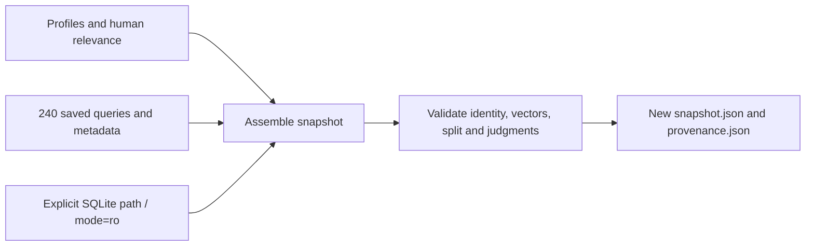

# Data preparation and a CPU PyTorch retrieval notebook

Real catalog downloads and the original query-geometry blocker are documented
in [real-catalog.md](real-catalog.md) and its [measured results](real-catalog-verification.md).
The authorized [corrected bundle](embedding-bundle.md) has separate [verification](embedding-bundle-verification.md).

The next stage, including blinded relevance forms and Docker setup, is covered
in [annotation-and-runtime.md](annotation-and-runtime.md).

Read this guide in pipeline order: inspect data -> export a frozen snapshot ->
validate it -> run the existing experiments. The final section teaches the tensor
math in a separate environment. Code, comments, and notebook explanations use
English; user-facing analysis output keeps its existing language and behavior.

## 1. Intuition: validate inputs before interpreting a score

Many photos of one person are not many independent subjects. The same image in
dev and test can inflate apparent quality even when it has different case or
subject IDs. A preflight report makes these problems visible before an AI call.

The tool diagnoses structure and exact duplicates. It does not repair data,
change labels, assign subjects, or prove that reference judgments are correct.

Implementation map:

1. [schemas.py](../app/evaluation/schemas.py) defines the existing manifest contract.
2. [image_inspection.py](../app/evaluation/image_inspection.py) decodes and hashes files.
3. [preflight.py](../app/evaluation/preflight.py) aggregates readiness and support.
4. [preflight_dataset.py](../scripts/preflight_dataset.py) is the thin CLI.


## 2. Analysis preflight schema and behavior

Use the analysis manifest described in [evaluation.md](evaluation.md). Real-photo
cases require image_path, consent_confirmed, a pseudonymous subject_id, a dev/test
split, and canonical reference labels. Paths are relative to the manifest.

Each image inspection records dimensions, issue codes and two SHA-256 hashes:

- encoded_sha256 identifies identical file bytes.
- rgb_sha256 identifies exact decoded RGB pixels after applying EXIF orientation;
  dimensions are included in the hash. Metadata or lossless encoding differences
  can therefore be ignored when the visible pixels are identical.

The tool forces image decoding to detect truncated files, then reuses the
application's existing hard format/resolution rules. It does not turn soft
lighting/detail heuristics into new acceptance thresholds. EXIF normalization is
only for the diagnostic fingerprint; files and production preprocessing remain
unchanged. The report stores no image pixels or EXIF metadata.

Cross-split duplicates are blocking errors even when subject IDs differ.
Within-split duplicates are warnings requiring review. Both hash methods may
report the same group; these are two detection signals, not two independent
quality failures. Exact fingerprints do not detect every resized, cropped,
lossily recompressed, or merely similar photo, and do not recognize a person.

Support reports case count and distinct subject count per split and observed
label. Absent classes do not appear in this observed-support table; compare it
with the full taxonomy in evaluation.md. There is no arbitrary minimum sample
count enforced by the tool.

```powershell
python -m scripts.preflight_dataset --kind analysis --dataset evals/local/analysis.dataset.json --output-dir build/preparation/analysis-001
```

The output directory must be new. report.json holds full details; report.md shows
issues and support tables. Exit code 0 means mechanical checks passed; exit code
2 means blocked and a report was still written. An invalid schema sets
inspection_complete=false and skips image inspection rather than guessing how
to interpret invalid records. Filesystem failures while opening the manifest
itself remain ordinary CLI errors.

A synthetic analysis manifest has no image paths: its image inspection is marked
not_applicable, with a warning. Its counts can be checked, but this is not
confirmation that human image data is ready. Consent and annotation independence
are declarations that still require human verification.

## 3. Retrieval preflight

This path uses [RetrievalSnapshot](../app/evaluation/retrieval_schema.py) and the
same candidate/judgment helper as ablation. It checks schema, vector validity,
template signature, subject splits, a non-empty eligible pool and complete
relevance judgments. It reports eligible/judged/positive counts per case.

```powershell
python -m scripts.preflight_dataset --kind retrieval --dataset evals/synthetic/retrieval.snapshot.json --output-dir build/preparation/retrieval-001
```

No catalog image URL is fetched, no encoder is loaded, and no AI is called.
Readiness is about the input contract, not recommendation accuracy.

## 4. Exporter intuition and request schema

A reproducible ranking experiment needs the catalog/vectors actually used,
not an implicit connection to whichever DB is configured today. The exporter
therefore requires an explicit SQLite path and uses saved query vectors only.

Copy [the request template](../evals/templates/retrieval-export.request.example.json)
to evals/local/export-request.json. It contains:

- dataset_id, version, synthetic and annotation_protocol.
- cases with case_id, subject_id, split and the existing RetrievalProfile fields.
- relevance: outfit-ID strings mapped to independent integer grades 0..3.

The template deliberately has empty relevance and is invalid until real judgments
are supplied. It never invents labels from the recommender's own bias tags or
match score. Every eligible, deduplicated candidate must be judged. Duplicate
case IDs, subject split leakage, unknown IDs, and incomplete judgment pools fail.

Query text and query vectors do not belong in the request: the exporter builds
the text with production templates and retrieves its vector from the saved bundle.

## 5. Export pipeline and read-only boundary

Read these files in order:

1. [snapshot_export.py](../app/evaluation/snapshot_export.py): request and orchestration.
2. [sqlite_catalog.py](../app/evaluation/sqlite_catalog.py): SQLite reading boundary.
3. [retrieval_schema.py](../app/evaluation/retrieval_schema.py): output validation.



The DB connection uses URI mode=ro, PRAGMA query_only and a read transaction.
A missing database is never created. Only the outfits table is selected;
application startup, init_db, migrations, device IDs and analysis history are
outside this path. The source is never edited to make export succeed.

Normal SQLite read transactions include committed WAL data. SQLite may use lock
or shared-memory sidecars even for read-only clients. For an absolutely untouched
source directory, export from a consistent offline copy/SQLite backup, rather
than copying a live main DB file without its committed WAL state.

All encoded catalog rows are exported in ascending ID order; unencoded rows are
excluded and counted. Image duplicates remain in the snapshot so the shared
candidate-pool rules can select the first row exactly as documented. Unlike
serving a single profile, export validates every encoded row, including rows a
later occasion/gender filter might exclude. Dirty unused rows can block export.

Requirements:

- Exactly the 240 production query strings and the current query signature.
- Matching query/outfit backend, model and embedding version.
- Finite, unit-normalized, 512-dimensional query and outfit vectors.
- Existing little-endian float32 BLOB format for outfit vectors.
- Explicitly synthetic inputs must agree across request, queries and catalog.
  Real inputs require a supported real backend; dummy is rejected.
- Vectors are never normalized, regenerated, repaired or inferred by export.

Metadata declarations cannot prove semantic authenticity: preserve trustworthy
encoder provenance when preparing the source. Synthetic fixtures remain labeled
synthetic throughout the pipeline.

```powershell
python -m scripts.export_retrieval_snapshot --request evals/local/export-request.json --database evals/local/catalog-copy.db --output-dir build/preparation/export-001
python -m scripts.preflight_dataset --kind retrieval --dataset build/preparation/export-001/snapshot.json --output-dir build/preparation/export-preflight-001
python -m scripts.run_retrieval_ablation --snapshot build/preparation/export-001/snapshot.json --split dev --output-dir build/preparation/ablation-001
```

The default query files are data/query_vectors.json and its sibling
query_vectors.meta.json. --query-vectors and --query-metadata accept explicit
paths. The exporter does not read DATABASE_URL or GEMINI_API_KEY, import the
application DB module, or enter the runtime encoder fallback path.

Validation completes before output is created. Existing output directories are
rejected. provenance.json records the request/vector/metadata hashes, exact
exported catalog hash, embedding identity, counts, SQLite version and source
fingerprint. The catalog hash describes rows observed in the read transaction;
it does not pretend that hashing a main DB file captures live WAL state.

## 6. Run a complete offline preparation example

```powershell
python -m pip install -r requirements-test.txt
python -m scripts.run_data_preparation_smoke --output-dir build/preparation/smoke-001
```

The smoke command creates a generated image, a synthetic SQLite catalog and an
artificial 240-template vector bundle under the new output directory. It then
runs preflight, read-only export, retrieval preflight and ablation, verifying the
synthetic source DB bytes remain unchanged. Committed embeddings are not edited.

The analysis manifest preflight in this smoke is synthetic/schema-only; direct
inspection of the generated image tests the image-reading boundary. Unit tests
cover human-manifest schema fixtures with generated files, including cross-split
duplication and malformed images. No personal photo is used in verification.

The backend CI now also runs this preparation smoke. It uploads synthetic
reports/exports; the generated source DB and source bundle are not included in
that added artifact selection. PyTorch is still absent from backend dependencies.

## 7. Optional learning environment: CPU PyTorch

[retrieval_with_pytorch.ipynb](../notebooks/retrieval_with_pytorch.ipynb) teaches:

1. Vector direction, L2 normalization and cosine similarity.
2. Query/candidate tensor shapes and batched matrix multiplication.
3. Top-k selection with stable tie handling.
4. A shared candidate pool from the synthetic snapshot.
5. Full score/ID parity with NumPy and production vector-only retrieval.
6. Connection to the existing relevance metrics and explicit failure cases.

[retrieval_tensors.py](../app/learning/retrieval_tensors.py) contains small helpers.
normalize_rows rejects zero/near-zero and non-finite vectors. batched_cosine_scores
normalizes floating-point CPU matrices, multiplies batches and returns the full
score matrix. stable_top_k uses stable argsort/gather so tied scores retain
candidate order. inference_mode prevents gradient tracking; there is no training.

Batching here limits one matrix multiplication's query rows, not the complete
output allocation. This teaching implementation is not a large-catalog index.

Keep its dependencies separate:

```powershell
python -m venv .venv/learning
.venv/learning/Scripts/python.exe -m pip install -r requirements-learning.txt
.venv/learning/Scripts/python.exe -m pip install -r requirements-learning-torch.txt
.venv/learning/Scripts/python.exe -m pytest -q tests/test_learning_retrieval.py
.venv/learning/Scripts/python.exe -m scripts.execute_retrieval_notebook --output-dir build/learning/notebook-001
```

On Linux replace Scripts/python.exe with bin/python; other platforms should
follow the official installation instructions linked below. Install the two
requirement files in separate commands: the Torch file selects the official
CPU-wheel index, while notebook packages come from PyPI. Torch 2.7.1 is a tested
teaching pin, not a claim to be the newest release. No pretrained weights or CUDA
packages are downloaded.

The execution script creates a temporary local kernelspec using its exact Python
interpreter and directs Jupyter runtime/config into the output directory. It
restores environment variables after execution. The source notebook stays
output-free; executed.ipynb and summary.json are separate artifacts. On failure,
the executed cells are retained for debugging. Closing the temporary kernel
removes its local runtime state.

The lightweight backend suite skips the optional Torch test module. The learning
environment runs those tests explicitly. A passing tensor example demonstrates
PyTorch/inference skills; model training or AI quality improvements need separate
data, experiments and evidence.

## 8. Verification and references

```powershell
python -m pytest -q --allow-hosts=127.0.0.1,::1 --allow-unix-socket
ruff check app scripts tests
ruff format --check app scripts tests
```

No actual user DB, Gemini request or model encoder is used by the preparation
tests. The notebook uses CPU arithmetic and synthetic vectors only.

Official references:
[SQLite URI read-only mode](https://docs.python.org/3/library/sqlite3.html#how-to-work-with-sqlite-uris),
[Pillow EXIF transpose](https://pillow.readthedocs.io/en/stable/reference/ImageOps.html#PIL.ImageOps.exif_transpose),
[CPU PyTorch installation](https://pytorch.org/get-started/previous-versions/),
[normalization](https://docs.pytorch.org/docs/2.7/generated/torch.nn.functional.normalize.html),
[stable sort](https://docs.pytorch.org/docs/2.7/generated/torch.sort.html),
[NBClient execution](https://nbclient.readthedocs.io/en/latest/client.html).
