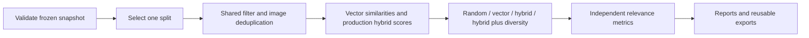

# Experiments: F3 ablation, paired analysis comparison, and CI

To prepare independent judgments and run the containerized backend, continue with
[annotation-and-runtime.md](annotation-and-runtime.md).

This guide builds on [evaluation.md](evaluation.md). Read the intuition first,
then the schemas and orchestration functions linked below. All committed examples
are synthetic; their scores are properties of fixtures, not evidence that the
fashion model is accurate or that one production approach is better.

## 1. Intuition: change one stage while holding inputs fixed

F3 has multiple stages: filter the catalog, retrieve by vector similarity, combine
similarity with styling rules, then select a diverse result. To understand each
stage's contribution, compare variants on the same queries and candidate pool.

| Variant | Ordering | Final selection |
| --- | --- | --- |
| filtered_random | One seeded shuffle | First k |
| vector_only | Descending vector dot product | First k |
| hybrid | Existing production weighted score | First k |
| hybrid_diverse | Same production weighted score | Existing diversity selector |

All four variants share occasion filtering, male gender aliases, vector inputs,
catalog order, and non-empty image-URL deduplication. These controls prevent a
ranker from looking better merely because it searched an easier candidate pool.
Category diversity is intentionally applied only in hybrid_diverse so its effect
can be measured separately. Its existing second pass may relax the category cap
to fill results, while image uniqueness remains enforced.

Random uses a stable per-case seed derived from the chosen seed and case ID. It
does not change the global random state, and reordering cases does not change a
case's random result. One draw is descriptive: compare several seeds before
drawing conclusions about a random baseline.

## 2. Snapshot schema: freeze the experiment inputs

[retrieval_schema.py](../app/evaluation/retrieval_schema.py) defines a file contract:

- dataset_id, version, synthetic, annotation_protocol identify the data/provenance.
- embedding declares the common backend/model/version of query and outfit vectors.
  Synthetic snapshots must declare backend=synthetic; real snapshots must use a
  supported real backend. This checks declarations, not whether an encoder was
  honestly used; preserve encoder metadata when preparing real snapshots.
- query_signature must match the 240 unchanged production query templates.
- outfits is the catalog in its original order. Each item has the attributes used
  by ranking plus a 512-dimensional vector. IDs must be unique.
- cases contains a pseudonymous subject_id, dev/test split, profile, exact
  production query_text, query_vector, and independent outfit relevance judgments.
- Vectors must be finite and already unit-normalized. Invalid vectors are rejected
  rather than silently corrected into a different experiment.
- Subjects cannot appear in both dev and test.
- Relevance grades are integers 0..3. Every eligible, image-deduplicated candidate
  needs a judgment because any variant, including random, can return it.
  Judgments for other catalog items are allowed but excluded from that case's IDCG.

The [synthetic snapshot](../evals/synthetic/retrieval.snapshot.json) is a complete
runnable example. Its vectors are handwritten unit vectors; its relevance labels
are artificial. For a real benchmark, provide actual compatible image/text
embeddings and independently annotated relevance. Do not generate reference
relevance from the same season/body bias tags used by hybrid ranking.

The evaluator accepts prepared snapshots. A read-only exporter now builds these
from an explicit SQLite catalog and saved query vectors; see
[data-preparation.md](data-preparation.md). Catalog images are not downloaded or
encoded by these tools. Keep private snapshots in evals/local/.

## 3. F3 pipeline and implementation map



Start at evaluate_snapshot() in
[retrieval.py](../app/evaluation/retrieval.py). candidate_pool() builds one shared
pool; rank_variants() computes scores once and applies four clear selection paths.

Production [ranking.py](../app/services/recommendation/ranking.py) supplies the
hybrid formula and diversity selector. Its numerical rules were not copied or
changed. [catalog_policy.py](../app/services/recommendation/catalog_policy.py)
shares the existing image deduplication and male aliases between SQL loading and
the evaluator. For historical compatibility, blank image URLs are not deduplicated
at the catalog stage; the production diversity selector retains its own behavior.

RankableOutfit in [types.py](../app/services/recommendation/types.py) is a Protocol:
a description of the fields ranking reads. Both an ORM row and a plain snapshot
record provide those fields. The protocol does not run code or query a DB. It
lets ranking remain storage-independent without adding another ranking algorithm.

```powershell
python -m scripts.run_retrieval_ablation --snapshot evals/synthetic/retrieval.snapshot.json --split dev --seed 42 --top-k 6 --output-dir build/experiments/f3-001
```

Outputs include report.json, report.md, one predictions file per variant, and
judgments.dataset.json. The latter contains exactly the eligible judgment pool,
so rescoring exports reproduces the same NDCG denominator:

```powershell
python -m scripts.evaluate_ranking_exports --dataset build/experiments/f3-001/judgments.dataset.json --predictions build/experiments/f3-001/hybrid_diverse.predictions.json --top-k 6 --output build/experiments/f3-001/rescored.json
```

Metrics retain the definitions in evaluation.md: Precision@k has fixed denominator
k; Hit@k is binary; NDCG uses linear relevance gain and is undefined for an all-zero
pool. Empty or unjudged pools are preflight errors, not cases silently dropped
from an average. Ties preserve catalog order. Scores/reason tags are diagnostics,
not independent relevance judgments.

## 4. Paired comparison: compare the same cases, including failures

A paired comparison asks what changed for each fixed input between a baseline
run and a candidate run. Case IDs alone cannot establish that inputs match.

[comparison_schema.py](../app/evaluation/comparison_schema.py) validates metadata
and evidence before [comparison.py](../app/evaluation/comparison.py) computes
anything. [comparison_report.py](../app/evaluation/comparison_report.py) handles
only presentation.

The reader requires artifact_schema_version=1 and selected_case_ids in run.json.
The analysis runner now writes both fields. Older, unversioned runs must be
regenerated using the current runner; the comparison never guesses whether an
old or interrupted file contains all intended cases.

Compatibility checks require:

1. The same dataset ID/version/manifest hash, selected split, provider, synthetic
   flag, reference kind, and evaluation mode.
2. Exactly the selected case set in each run, without missing/extra/duplicate rows.
3. Matching subject, feature, and reference labels for each case.
4. Matching original image hashes when both are available. If a read failure
   prevents hashing, the case stays in the comparison with an explicit warning.
5. Successful results must be valid live API models; demo results are rejected.

Differences in requested model, SDK, inference settings, runtime dependency
versions, source hash, prompt bundle, and observed provider model versions are
disclosed. A changed processed-image hash is flagged. This permits deliberate
model or prompt comparisons without pretending that changed settings were held
constant. A descriptive comparison cannot establish a prompt's causal effect.

```powershell
python -m scripts.compare_analysis_runs --baseline build/evaluation/run-a --candidate build/evaluation/run-b --output-dir build/experiments/analysis-a-vs-b
```

Both input directories must come from the same manifest/split. For a smoke
example, run the same synthetic dataset twice into new directories. Its quality
outcomes should match, although timings vary. Real prompt A/B runs require real
credentials, consented data, independent reference labels, and frozen settings.

## 5. Read the comparison results

Every delta is candidate minus baseline. comparison.json includes recomputed
baseline/candidate metrics, configuration differences, status transitions,
per-case evidence summaries, and quality deltas. comparison.md and cases.csv are
compact views; original cases.jsonl retains complete raw/repair traces.

For each reference field, a case is improved, regressed, unchanged_correct, or
unchanged_incorrect. An error produces no label and counts as incorrect. Therefore
recovering an error is visible, and failed cases remain in accuracy denominators.

Latency deltas include all cases; a separate mean covers pairs where both runs
succeeded. Inspect status transitions first: failing quickly can appear faster.

Total token usage is complete only when every provider attempt reports
total_token_count. Otherwise the complete total and its paired delta are null.
Observed partial tokens are retained separately. Zero attempts means no provider
request and a known total of zero. Aggregate token deltas use only pairs with
complete usage in both runs and report the size of that subset. Tokens are not
currency cost, and missing usage is not free inference.

Aggregates are recomputed from evidence, not copied from report.json. Outputs
require a new directory and never overwrite earlier experiments. No statistical
significance, production SLO, or AI quality improvement is inferred automatically.

## 6. CI: install dependencies, verify code, run synthetic experiments

[backend-ci.yml](../.github/workflows/backend-ci.yml) runs on push, ordinary pull
request, or manual dispatch. It defines Python 3.12 and 3.13 jobs on Ubuntu 24.04:

1. Checkout source and set up Python.
2. Install [requirements-test.txt](../requirements-test.txt).
3. Run pip check, Ruff, formatter verification, and pytest.
4. Run the offline evaluation smoke phase.
5. Upload only synthetic smoke artifacts for review, retained for seven days.

requirements-test.txt includes production dependencies and small test tools.
requirements-dev.txt includes that file plus FashionCLIP/encoding dependencies.
CI does not install FashionCLIP, Torch, or model weights.

The jobs use a dummy Gemini key and in-memory DB configuration. No API secret is
read by the workflow. pytest-socket blocks external TCP connects during tests,
allowing only loopback/Unix sockets needed by event loops and ASGI test clients.
The smoke command applies the same policy in its process. This is an accidental
network-call guard, not OS-level isolation of arbitrary subprocesses. Dependencies
must be downloaded during installation; artifact upload also uses the network.

```powershell
python -m pip install -r requirements-test.txt
python -m pip check
ruff check app scripts tests
ruff format --check app scripts tests
python -m pytest -q --allow-hosts=127.0.0.1,::1 --allow-unix-socket
python -m scripts.run_evaluation_smoke --output-dir build/experiments/local-ci
```

[run_evaluation_smoke.py](../scripts/run_evaluation_smoke.py) runs two complete
synthetic analysis evaluations, compares their paired outcomes, then runs F3
ablation. It checks expected counts and equality of scripted quality outcomes,
without expecting identical execution time. The socket policy is restored even
when a smoke check fails.

GitHub runs can only be confirmed after the workflow executes on the remote
repository. Local command execution and workflow syntax validation do not prove
that a hosted job has passed. This implementation does not push or deploy code.

Official references:
[checkout v6](https://github.com/actions/checkout/tree/v6),
[setup-python v6](https://github.com/actions/setup-python/tree/v6),
[artifact upload v4](https://github.com/actions/upload-artifact/tree/v4),
[pytest-socket](https://github.com/miketheman/pytest-socket).
